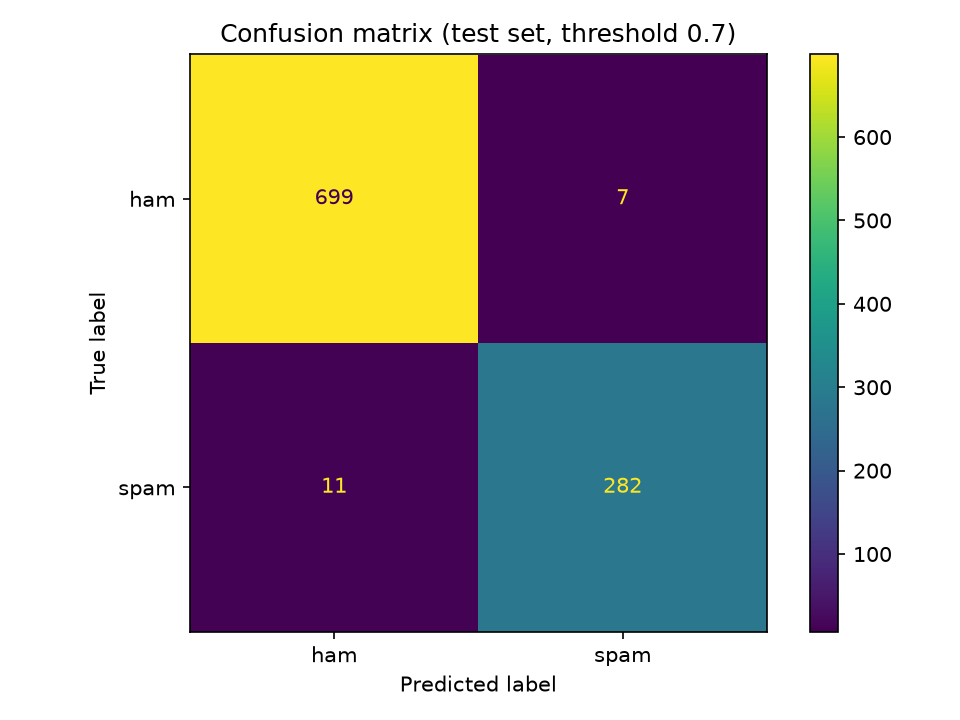
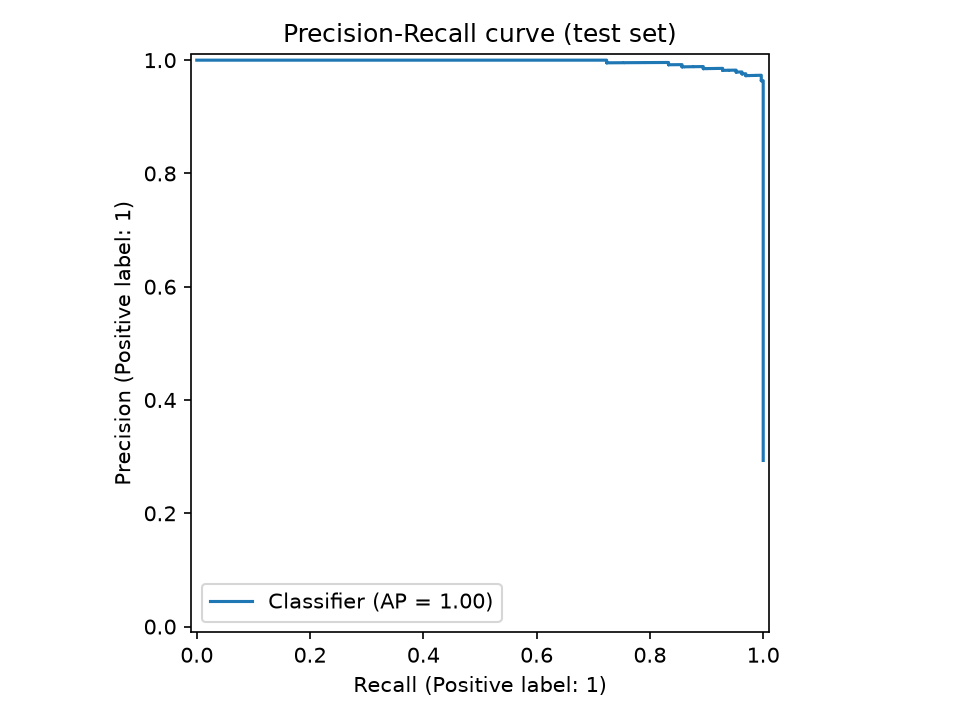
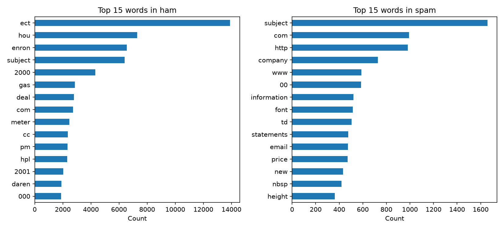

# Spam Email Classifier


A machine learning project that classifies emails as **spam** or **ham** (legitimate). It uses TF-IDF text features and a Logistic Regression model, with a command-line menu to train the model and check new emails.

## Table of Contents
- [Problem](#problem)
- [Dataset](#dataset)
- [Approach](#approach)
- [Results](#results)
- [What the model learned (and its bias)](#what-the-model-learned-and-its-bias)
- [Limitations](#limitations)
- [Installation](#installation)
- [Usage](#usage)
- [Project Structure](#project-structure)
- [Future Improvements](#future-improvements)
- [Author](#author)
- [License](#license)

## Problem
A company wants spam filtered out of its inbox automatically. The two mistakes do not cost the same:

| Mistake | Meaning | Cost |
|---|---|---|
| False positive | A real email is sent to spam | High: an important email may be lost |
| False negative | A spam email reaches the inbox | Low: an annoyance |

For this reason accuracy alone is not used. The project looks at **precision, recall, F1 and PR-AUC**, and uses an adjustable decision threshold.

## Dataset
- Source: [Spam Mails Dataset](https://www.kaggle.com/datasets/venky73/spam-mails-dataset) on Kaggle (the `enron1` part of the Enron-Spam corpus), license CC0.
- File used: `spam_ham_dataset.csv`
- 5,171 emails: 3,672 ham and 1,499 spam (28.99% spam).
- 178 rows had duplicate text. They were removed before splitting, leaving **4,993 emails**.
- Split: 3,994 train / 999 test, stratified, `random_state=42`.

The dataset is **not included** in this repository. See [Installation](#installation).

## Approach
1. Data audit and EDA (class balance, duplicates, email length, most common words).
2. Remove duplicate emails, then split. The test set is not touched until the end.
3. A single scikit-learn `Pipeline`: `TfidfVectorizer` followed by a classifier. The vectorizer is fitted only on training data, so there is no leakage.
4. Baseline (`DummyClassifier`) and three models compared with 5-fold stratified cross-validation on the training set.
5. Hyperparameter tuning with `GridSearchCV` (training data only).
6. One final evaluation on the test set, then error analysis.

### Model comparison (5-fold CV on the training set)

| Model | Accuracy | Precision | Recall | F1 | PR-AUC |
|---|---|---|---|---|---|
| Dummy (most frequent) | 0.7073 | 0.0000 | 0.0000 | 0.0000 | 0.2927 |
| Naive Bayes | 0.9627 | 0.9794 | 0.8913 | 0.9331 | 0.9907 |
| Logistic Regression | 0.9865 | 0.9706 | 0.9837 | 0.9771 | 0.9943 |
| Linear SVM | 0.9902 | 0.9774 | 0.9897 | 0.9834 | 0.9964 |

The dummy model reaches 70.7% accuracy by always answering "ham", which is why accuracy is misleading on this data.

After tuning, Logistic Regression (C=100, unigrams, `min_df=2`) reached a CV F1 of 0.9847 (std 0.0031) and Linear SVM 0.9838 (std 0.0034). The difference is smaller than the fold-to-fold variation, so the two are treated as equal. Logistic Regression was chosen because it outputs a score that can be thresholded.

## Results
Final model: Logistic Regression, evaluated once on the held-out test set (999 emails: 706 ham, 293 spam) at a decision threshold of **0.7**.

| | Precision | Recall | F1 |
|---|---|---|---|
| Ham | 0.9845 | 0.9901 | 0.9873 |
| Spam | 0.9758 | 0.9625 | 0.9691 |

Accuracy 0.9820, PR-AUC 0.9967.

| | Predicted ham | Predicted spam |
|---|---|---|
| Actual ham | 699 | 7 |
| Actual spam | 11 | 282 |




### About the threshold
The test set was looked at twice, and both results are reported:

| Threshold | Real emails marked spam (FP) | Spam missed (FN) |
|---|---|---|
| 0.5 (first look) | 8 | 1 |
| 0.7 (final) | 7 | 11 |

The threshold of 0.7 was chosen on training-set cross-validation results, assuming that losing a real email is about five times worse than seeing one spam email, **before** the test set was evaluated at 0.7. On the test set this threshold turned out slightly worse than 0.5 under the same assumption. It was kept to avoid tuning on the test set. With only 706 real emails in the test set, a difference of one email is small. A real client should set this trade-off from their own cost of each mistake.

## What the model learned (and its bias)


The dataset has a built-in bias: the ham emails come mostly from Enron employees, while the spam comes from other sources. In the model's strongest ham features, many are Enron-specific (`enron`, `hpl`, `hou`, `ect`, `daren`, `meter`, `gas`) or years (`2000`, `2001`), while spam is linked to words like `http`, `viagra`, `cheap` and the years 2004 and 2005.

A check: removing 15 of these words (Enron names and years) lowered the cross-validated F1 from 0.9847 to 0.9754. The model has therefore learned real spam signals, but part of its performance comes from Enron-style language.

## Limitations
- The model was trained on Enron-era English emails (about 2000-2005). Its test score says how it does on **similar** data, not on a different company's inbox.
- Real emails that do not look like Enron business email (personal messages, jokes, order confirmations) were the ones wrongly marked as spam.
- Spam with deliberately misspelled or broken words (for example `a pprov a l`) is often missed, because TF-IDF only sees whole words.
- The score shown for an email is not a calibrated probability. A very high or low value should not be read as certainty.
- The test set was evaluated at two thresholds (see above).
- English only.

Before using this on another organisation's email, it should be re-evaluated and probably retrained on that organisation's own data.

## Installation
Requires Python 3.13. Windows PowerShell commands:

```powershell
git clone https://github.com/Charan-Code600/Spam-Email-Classifier.git
cd Spam-Email-Classifier
python -m venv venv
.\venv\Scripts\Activate.ps1
pip install -r requirements.txt
```

Download `spam_ham_dataset.csv` from the [Kaggle dataset](https://www.kaggle.com/datasets/venky73/spam-mails-dataset), create a folder named `data` in the project folder, and place the file there:

```
Spam-Email-Classifier\data\spam_ham_dataset.csv
```

## Usage
```powershell
python main.py
```

```
==============================
  Spam Email Classifier
==============================
1. Train model and show test results
2. Check an email
3. Show model info
4. Exit
```

- Choose **1** first. It trains the model, saves it to `models/`, and prints the test results.
- Choose **2** to paste an email (finish with a line containing only `END`). Example result:

```
Result: SPAM  (spam score: 100.0%)
```

The `models/` and `reports/` folders are created automatically when needed.

## Project Structure
```
Spam-Email-Classifier/
├── data/               (not in the repo: put the CSV here)
├── models/             (created when the model is trained)
├── reports/            charts used in this README
├── src/
│   ├── config.py       paths, random seed, test size, threshold
│   ├── data_loader.py  load and clean the CSV
│   ├── eda.py          data audit and charts
│   ├── preprocess.py   duplicates, split, TF-IDF pipeline
│   ├── train.py        model comparison, tuning, final model, saving
│   ├── evaluate.py     test-set metrics and charts
│   ├── error_analysis.py  wrong predictions and model weights
│   └── predict.py      load the model and classify one email
├── main.py             command-line menu
├── requirements.txt
└── README.md
```

The audit, comparison, tuning, error analysis and word-removal check are functions in `src/` that were run during development; the menu runs training, evaluation and prediction.

## Future Improvements
- Train and test on a second, different email dataset to measure real generalisation.
- Character-level features to handle misspelled spam.
- Probability calibration so the score can be trusted as a probability.
- A simple web interface (Streamlit or FastAPI).

## Author
**Charan Aade**
- GitHub: [Charan-Code600](https://github.com/Charan-Code600)
- LinkedIn: [charanaade](https://www.linkedin.com/in/charanaade)

## License
This project is licensed under the MIT License. See the [LICENSE](LICENSE) file.

